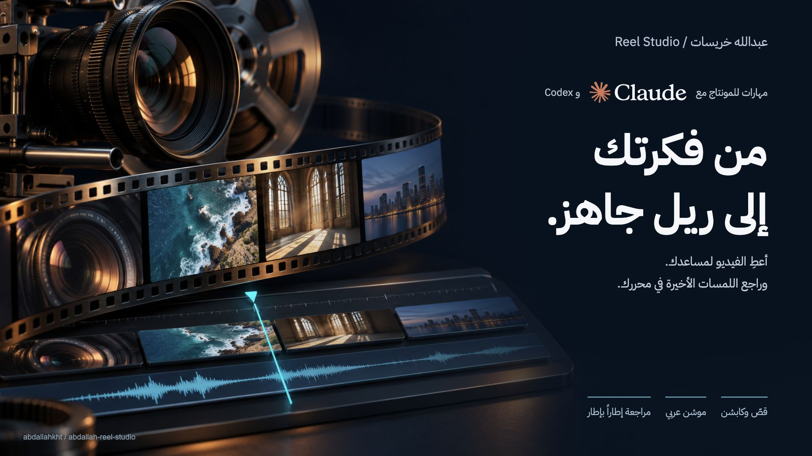
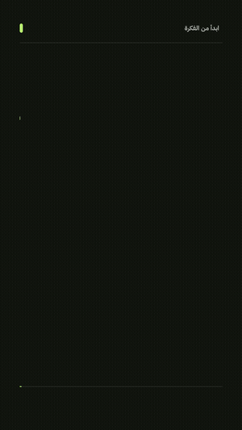
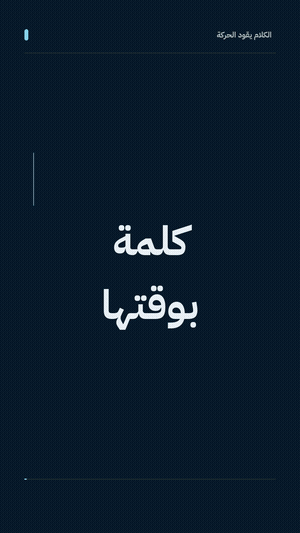
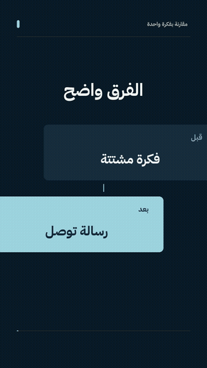
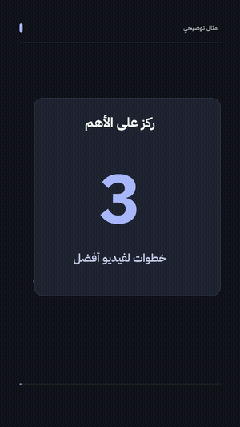
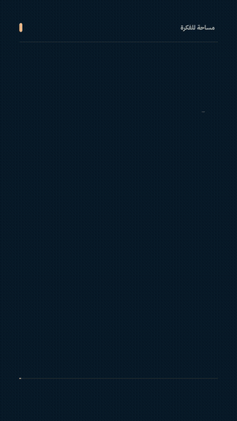
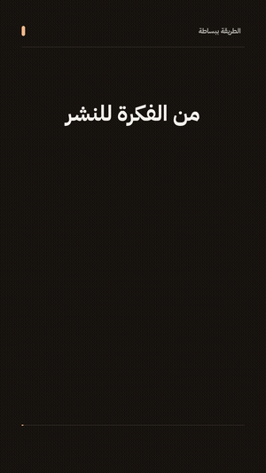
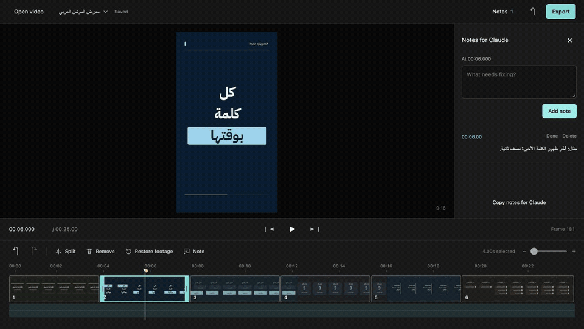
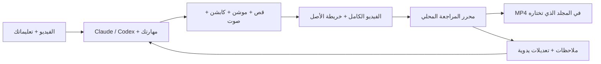

  

  <b>مساعدك يعمل المونتاج. وأنت تراجع اللمسات الأخيرة.</b> 
  أعطِ Claude أو Codex الفيديو والتعليمات، ثم افتح النتيجة في محرر بسيط على جهازك.

  
  
  
  

  <a href="https://abdallahkht.github.io/abdallah-reel-studio/"><b>شاهد المعرض</b></a> &nbsp;·&nbsp;
  <a href="#workflow">طريقة العمل</a> &nbsp;·&nbsp;
  <a href="#review">المحرر</a> &nbsp;·&nbsp;
  <a href="#start">ابدأ هنا</a> &nbsp;·&nbsp;
  <a href="https://github.com/abdallahkht/abdallah-reel-studio/releases/latest/download/abdallah-reel-studio-v0.2.0.zip"><b>تحميل ZIP</b></a>

## الفكرة بنظرة

| | |
|---|---|
| **أنت تعطيه** | الفيديو الخام وتعليماتك. المرجع، الصور وتسجيل الشاشة اختياريون. |
| **المساعد يعمل** | القص، الموشن، الكابشن والصوت، باستخدام مهاراتك والأدوات المتاحة في جلستك. |
| **أنت تراجع** | الفيديو الكامل. تحدّد ثانية أو إطاراً، تكتب ملاحظة، أو تصلح قصّاً صغيراً. |
| **أنت تحصل على** | MP4 نهائي ومشروع مراجعة مع الأصل وخريطة القص، عندما يدعم المشروع ذلك. |
| **مهاراتك تبقى** | استخدم مهارتك الحالية؛ مهارات المشروع تكملها ولا تستبدلها. |

## شاهد الحركة

كل مثال تحته ملفه القابل للتعديل. اضغط المعاينة لمشاهدته كفيديو في المعرض.

<table>
<tr>
<td width="33%" align="center"> <b>عنوان يثبت الفكرة</b> <a href="motion/templates/title.json">ملف القالب</a> · <a href="examples/title-demo.mp4">MP4</a></td>
<td width="33%" align="center"> <b>كل كلمة بوقتها</b> <a href="motion/templates/caption.json">ملف القالب</a> · <a href="examples/caption-demo.mp4">MP4</a></td>
<td width="33%" align="center"> <b>قبل وبعد</b> <a href="motion/templates/compare.json">ملف القالب</a> · <a href="examples/compare-demo.mp4">MP4</a></td>
</tr>
<tr>
<td align="center"> <b>رقم يستحق الانتباه</b> <a href="motion/templates/metric.json">ملف القالب</a> · <a href="examples/metric-demo.mp4">MP4</a></td>
<td align="center"> <b>مساحة للفكرة</b> <a href="motion/templates/quote.json">ملف القالب</a> · <a href="examples/quote-demo.mp4">MP4</a></td>
<td align="center"> <b>خطوة بخطوة</b> <a href="motion/templates/steps.json">ملف القالب</a> · <a href="examples/steps-demo.mp4">MP4</a></td>
</tr>
</table>

هذه أمثلة موشن أصلية صامتة، وليست مونتاجاً لفيديوهات شخصية. قالب الكلمات يوضّح الحركة؛ ليس نظام تفريغ كلام تلقائياً. الأرقام للتوضيح. [طريقة تعديل القوالب](motion/README.md).

## كيف يمشي المونتاج؟

1. **أعطِ الخام والتعليمات.** المساعد يفحص المادة ويختار اللقطات الكاملة بدون قص نهايات الكلمات أو تغيير المعنى.
2. **المساعد يجهّز الفيديو.** يضيف الموشن والكابشن والمواد المناسبة لكلامك. يحتفظ بالمشروع القابل للتعديل والأصل وخريطة القص.
3. **راجع الفيديو الكامل.** افتح النتيجة في المحرر. تنقّل إطاراً بإطار، عدّل قصّاً صغيراً، أو اترك ملاحظة في وقتها.
4. **اطلب التصحيح.** المساعد يقرأ الملاحظات ويحافظ على تعديلاتك اليدوية، ثم يسلّم نسخة كاملة جديدة عند الحاجة.
5. **صدّر.** اختر الجودة والمجلد من نافذة النظام. الملف الناتج يحتوي تعديلات التايملاين الحالية.

المحرر لا يشغّل Claude من نفسه؛ اطلب من المساعد قراءة ملاحظاتك في المحادثة. لا تحتاج إعادة شرح الفيديو كله في كل مرة.

## مساحة للمراجعة، بدون تعقيد

| ما تفعله | كيف؟ |
|---|---|
| مراجعة دقيقة | وقت بالمللي ثانية وتنقّل إطاراً بإطار باستخدام الأسهم |
| تصحيح القص | اسحب حافة المقطع، أو Split ثم Remove |
| استرجاع لحظة | Restore footage عندما يكون الأصل وخريطة القص متصلين |
| ملاحظة للمساعد | ملاحظة مرتبطة بالوقت، مع Delete وUndo |
| الرجوع لتعديل سابق | Undo وسجل نسخ محفوظ |
| إخراج الفيديو | 720p، 1080p، 2K أو 4K، ثم اختر مجلد الحفظ |

اللقطات أعلاه من المحرر الحقيقي مع مثال الموشن الموجود في المشروع. الجزء المسترجع يأتي من الخام؛ تمديد الموشن أو الصوت عليه يتم مع المساعد في المشروع الأصلي.

## ابدأ هنا

**[نزّل ZIP](https://github.com/abdallahkht/abdallah-reel-studio/releases/latest/download/abdallah-reel-studio-v0.2.0.zip)**، فك الضغط، وافتح المجلد في Claude Code أو Codex. ثم أرسل:

> جهّز هذا المشروع وثبّت المهارات الموجودة فيه بدون استبدال مهاراتي الحالية. افحص Python وFFmpeg ثم افتح المحرر.

عند تجهيز فيديو:

> عدّل هذا الفيديو كريل عربي 9:16. حافظ على المعنى ونهايات الكلمات. أضف موشن مناسباً للكلام، ثم افتح الفيديو الكامل في المحرر مع الأصل لاسترجاع القصوص.

المتطلبات الأساسية: Python 3.10+ وFFmpeg، ووصولك الخاص إلى Claude Code أو Codex. تجهيز الموشن اختياري. [خطوات Mac وWindows وLinux](docs/setup-ar.md).

## كيف بُني؟

| المجلد / الملف | ماذا تجد فيه؟ |
|---|---|
| [`skills/`](skills/) | مهارة المونتاج العربي، مهارة الموشن، ومهارة توصيل المراجعة |
| [`motion/`](motion/) | renderer أصلي وستة قوالب JSON قابلة للتعديل |
| [`examples/`](examples/README.md) | فيديوهات كاملة وصور معاينة لكل مثال |
| [`web/`](web/) | واجهة المحرر: المعاينة، التايملاين، الملاحظات والتصدير |
| [`server.py`](server.py) | الخادم المحلي، حفظ النسخ، استرجاع الأصل وتصدير FFmpeg |
| [`connect.py`](connect.py) | توصيل الفيديو النهائي وخريطة المصدر بالمحرر |
| [`docs/`](docs/) | التجهيز، طريقة العمل، الاختبارات ومصادر الأصول |
| [`assets/`](assets/) | الغلاف، لقطات المحرر، المعاينات المتحركة والخط المرخّص |

## ما الذي تم اختباره؟

| الجزء | الحالة |
|---|---|
| المحرر على Mac | جُرّبت المعاينة والقص والاسترجاع والملاحظات والتصدير. نافذة اختيار المجلد نفسها ما زالت تحتاج تحققاً عملياً. |
| أمثلة الموشن | ستة أمثلة مُخرجة، مع فحص العربية والأبعاد والإطارات. |
| المهارات | ملفات تعليمات جاهزة. تجربة عضو جديد كاملة من الخام إلى التسليم ما زالت مطلوبة. |
| Windows وLinux | مسارات تشغيل متوفرة؛ غير مختبرة بالكامل. |
| تنسيقات أخرى | الإصدار الحالي 9:16. اليوتيوب الأفقي مؤجّل. |

[تفاصيل الاختبارات والحدود](docs/testing.md). التكبير إلى 2K أو 4K لا يضيف تفاصيل غير موجودة بالأصل. واجهة المحرر حالياً بالإنجليزية، والمحتوى هنا موجّه للعربية.

## الترخيص

من **عبدالله خريسات** لمجتمعه، ومتاح للجميع وفق [MIT](LICENSE). خط IBM Plex Sans Arabic يأتي مع [ترخيصه](assets/fonts/OFL.txt). Claude وشعاره ملك Anthropic، وهذا مشروع مستقل غير تابع لها. [مصادر الأصول](docs/asset-sources.md).

