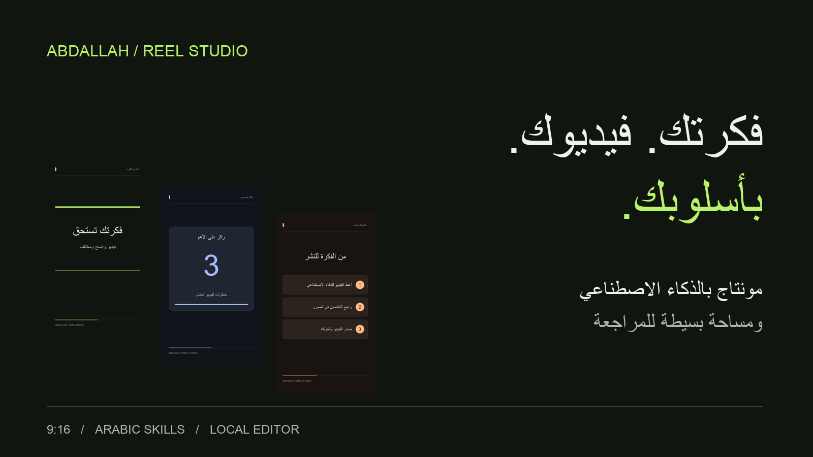
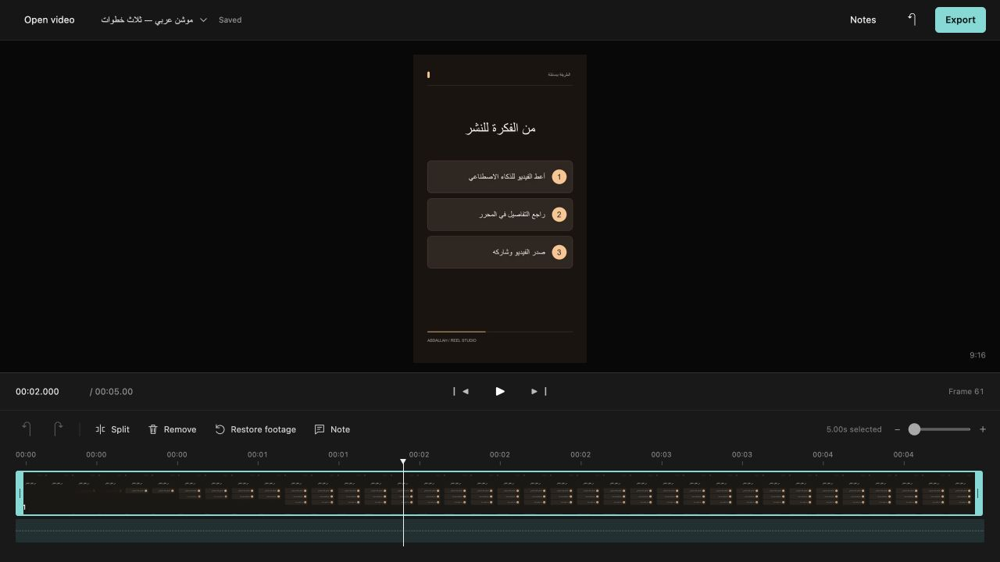

# عبدالله · Reel Studio

**أعطِ الفيديو للذكاء الاصطناعي. راجع التفاصيل. وصدّر.**

محرر بسيط على جهازك، مع skills عربية وقوالب موشن قابلة للتعديل. Claude أو Codex يعمل المونتاج، وأنت تراجع النتيجة وتصلح التفاصيل الصغيرة من التايملاين.

**[تحميل النسخة الجاهزة ZIP](https://github.com/Abood77777/abdallah-reel-studio/releases/latest/download/abdallah-reel-studio-v0.1.0.zip)** · **[ابدأ من هنا](docs/setup-ar.md)** · **[شاهد الأمثلة](examples/README.md)**

## كيف تبدأ؟

1. نزّل ZIP وفك الضغط في مجلد ثابت على جهازك.
2. افتح المجلد في Claude Code أو Codex، وأرسل له:

> جهّز هذا المشروع على جهازي وثبّت الـskills الموجودة فيه. افحص Python وFFmpeg أولاً، ثم افتح المحرر. لا تغيّر مهاراتي الحالية.

3. أعطه الفيديو الخام والتعليمات. المرجع وتسجيل الشاشة اختياريان:

> عدّل هذا الفيديو كريل عربي 9:16. اختر اللقطات الكاملة، أضف موشن مناسباً للكلام، ثم أعطني الفيديو النهائي وافتحه في المحرر مع إمكانية استرجاع الأجزاء المقصوصة.

## ماذا تحصل عليه؟

| الجزء | فائدته |
|---|---|
| المحرر | معاينة الفيديو، تنقّل إطاراً بإطار، قص بسيط، استرجاع، ملاحظات وحذفها، وتصدير إلى مجلد تختاره |
| [مهارة المونتاج](skills/abdallah-reel-edit/SKILL.md) | طريقة عمل للريلز العربية، تحافظ على معنى الكلام ونهايات الكلمات |
| [مهارة الموشن](skills/abdallah-reel-motion-kit/SKILL.md) | استخدام القوالب وتعديل الحركة والنصوص والألوان |
| [مهارة المراجعة](skills/abdallah-reel-review/SKILL.md) | توصيل الفيديو الكامل بالمحرر وقراءة ملاحظاتك في التعديل التالي |
| [قوالب الموشن](motion/README.md) | عنوان، رقم مهم، وشرح خطوات؛ JSON + كود + MP4 للمشاهدة |

## الفكرة ببساطة

المحرر لا يشغّل Claude تلقائياً. المهارات تعليمات يستخدمها مساعدك، وتحتاج وصولك الخاص إلى Claude Code أو Codex. التصدير والمراجعة يعملان محلياً؛ معالجة الفيديو بالذكاء الاصطناعي تعتمد على الأدوات التي تختارها في جلستك.

**الإصدار الأول: ريلز 9:16.** واجهة المحرر حالياً بالإنجليزية، والشرح والمهارات موجّهة للمحتوى العربي. تغيير الموشن أو الكابشن يتم مع المساعد؛ المحرر للمراجعة والتصحيحات الصغيرة. استرجاع القص يحتاج خريطة صحيحة تربط الفيديو النهائي بالأصل.

جرّبنا المحرر على Mac. تشغيل Windows وLinux متاح لكنه يحتاج تجربة إضافية. [ما تم اختباره والحدود الحالية](docs/testing.md).

المشروع من **عبدالله خريسات** لمجتمعه، ومتاح للجميع. تقدر تستخدمه وتعدّله وفق [MIT](LICENSE). [أرسل مشكلة أو اقتراحاً](https://github.com/Abood77777/abdallah-reel-studio/issues).

