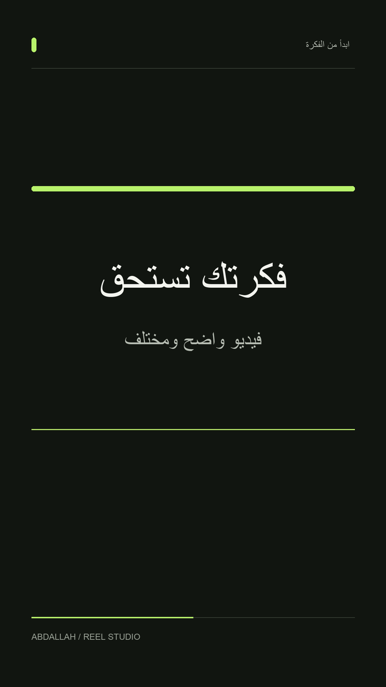
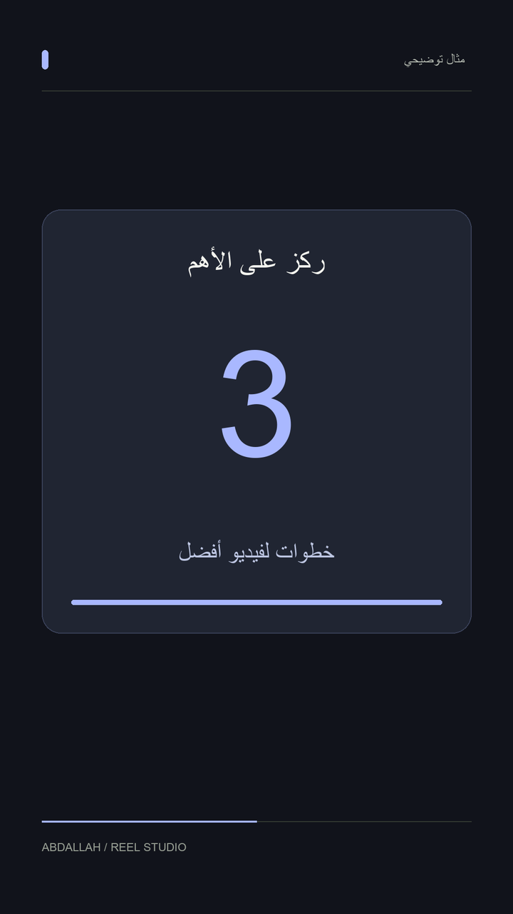
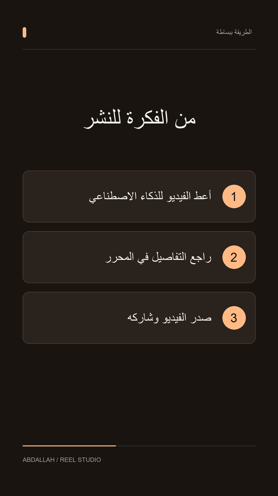

# أمثلة جاهزة للمشاهدة والتعديل

هذه أمثلة موشن صامتة، مولّدة من القوالب الأصلية الموجودة في المشروع. النصوص والأرقام للتوضيح، وليست نتائج أو وعوداً.

| عنوان | رقم مهم | شرح خطوات |
|---|---|---|
|  |  |  |
| [شاهد MP4](title.mp4) · [عدّل القالب](../motion/templates/title.json) | [شاهد MP4](metric.mp4) · [عدّل القالب](../motion/templates/metric.json) | [شاهد MP4](steps.mp4) · [عدّل القالب](../motion/templates/steps.json) |

اضغط الصورة لفتح ملف الفيديو، ثم Download أو View raw إذا لم يعرض GitHub المشغّل. بعد تنزيل المشروع تقدر تفتح MP4 مباشرة على جهازك.

أمثلة ريلز عبدالله الكاملة ستضاف لاحقاً بعد اختيار الملفات المخصصة للنشر. الإصدار الحالي لا يحتوي فيديوهات شخصية أو فيديوهات أعضاء.
